# SOC/EDR Unified Security Platform

Hệ thống Giám sát An ninh mạng (SOC) và Tự động Ứng phó Sự cố (SOAR / EDR) hợp nhất, ứng dụng kênh truyền nhị phân bảo mật gRPC mTLS, Trí tuệ Nhân tạo (AI Zero-Trust) và Nền tảng Tự động hóa n8n.

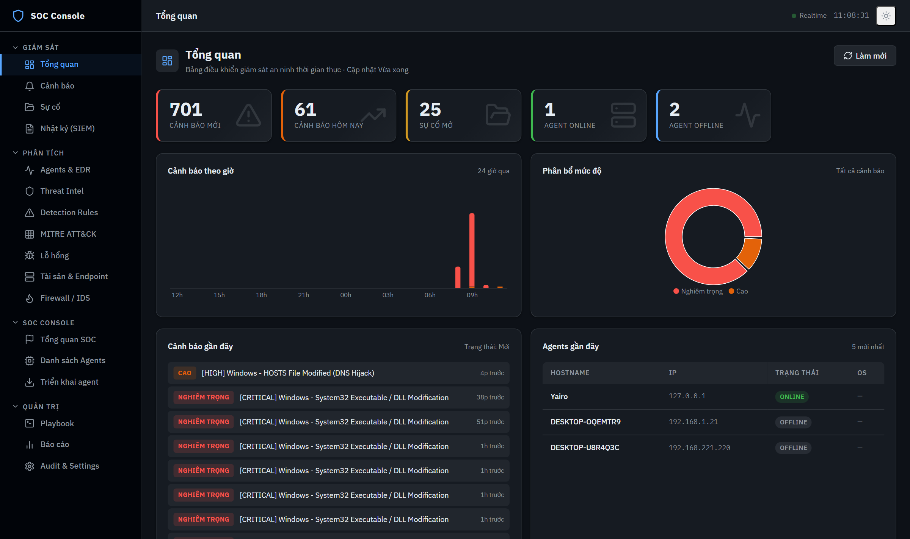

---

## Mục lục

1. [Giới thiệu tổng quan](#giới-thiệu-tổng-quan)
2. [Kiến trúc hệ thống](#kiến-trúc-hệ-thống)
3. [Các tính năng nổi bật](#các-tính-năng-nổi-bật)
4. [Giao diện người dùng và các phân hệ](#giao-diện-người-dùng-và-các-phân-hệ)
   - [Bảng điều khiển Tổng quan (Dashboard)](#1-bảng-điều-khiển-tổng-quan-dashboard)
   - [Giám sát và Quản lý Cảnh báo (Alerts)](#2-giám-sát-và-quản-lý-cảnh-báo-alerts)
   - [Ma trận Kỹ thuật Tấn công MITRE ATT&CK](#3-ma-trận-kỹ-thuật-tấn-công-mitre-attck)
   - [Quản lý Vụ việc An ninh (Case Management)](#4-quản-lý-vụ-việc-an-ninh-case-management)
   - [Chi tiết Vụ việc và Điều phối SOAR](#5-chi-tiết-vụ-việc-và-điều-phối-soar)
   - [Quản lý Quy tắc Phát hiện (Detection Rules)](#6-quản-lý-quy-tắc-phát-hiện-detection-rules)
   - [Trung tâm Tình báo Mối đe dọa (Threat Intel / IOC)](#7-trung-tâm-tình-báo-mối-đe-dọa-threat-intel--ioc)
   - [Giám sát Điểm cuối và EDR (Endpoint Agents)](#8-giám-sát-điểm-cuối-và-edr-endpoint-agents)
   - [Nhật ký Sự kiện SIEM (Security Event Logs)](#9-nhật-ký-sự-kiện-siem-security-event-logs)
   - [Danh mục Kịch bản Ứng phó Tự động (Playbooks)](#10-danh-mục-kịch-bản-ứng-phó-tự-động-playbooks)
   - [Nhật ký Kiểm toán Hệ thống (Audit Logs)](#11-nhật-ký-kiểm-toán-hệ-thống-audit-logs)
   - [Quản lý Tường lửa và Chặn IP (Firewall & IDS)](#12-quản-lý-tường-lửa-và-chặn-ip-firewall--ids)
5. [Công nghệ sử dụng](#công-nghệ-sử-dụng)
6. [Cấu trúc thư mục dự án](#cấu-trúc-thư-mục-dự-án)
7. [Hướng dẫn cài đặt và vận hành](#hướng-dẫn-cài-đặt-và-vận-hành)
8. [Kịch bản kiểm thử thực tế](#kịch-bản-kiểm-thử-thực-tế)
9. [Tác giả và Đồ án](#tác-giả-và-đồ-án)

---

## Giới thiệu tổng quan

Trong các trung tâm giám sát an ninh mạng (SOC) truyền thống, quy trình từ lúc phát hiện sự cố (SIEM) đến khi điều tra (Threat Intel) và cô lập mối đe dọa (EDR/Firewall) thường bị phân mảnh, đòi hỏi nhiều thao tác chuyển đổi giữa các công cụ độc lập và tốn nhiều thời gian của chuyên viên phân tích Tier 1. Tình trạng này dẫn đến hiện tượng bội thực cảnh báo (Alert Fatigue), kéo dài thời gian phát hiện trung bình (MTTD) và thời gian phản ứng trung bình (MTTR).

Dự án này xây dựng một **Nền tảng SOC / SOAR Hợp nhất (Unified SOC & SOAR Platform)** khép kín theo mô hình All-in-One:

- **Thu thập và giám sát thời gian thực:** soc-agent tự phát triển thu thập dữ liệu đo đạc (telemetry), nhật ký hệ thống, sự kiện tiến trình, kết nối mạng và toàn vẹn tệp (FIM), truyền trực tiếp về Core Server qua kênh nhị phân gRPC hai chiều được bảo vệ bằng mTLS.
- **Bộ quy tắc phát hiện động (Rule Engine in-memory):** Đánh giá sự kiện thời gian thực theo tập luật YAML/JSON, hỗ trợ nạp lại luật động (hot-reload), không làm gián đoạn tiến trình giám sát.
- **Tự động hóa SOAR và Trợ lý AI Zero-Trust:** Tích hợp workflow engine n8n kết hợp mô hình ngôn ngữ lớn (LLM / Ollama) để phân tích ngữ cảnh, tính điểm rủi ro và đề xuất hướng xử lý mà không mặc định tin tưởng bất kỳ cảnh báo nào.
- **Phê duyệt Human-in-the-Loop (HITL):** Tự động thông báo qua Telegram kèm nút phê duyệt một chạm, đảm bảo các quyết định có tác động lớn luôn có sự xác nhận của con người.
- **Phản ứng tích cực (Active Response EDR):** Truyền ngược lệnh từ Server xuống Agent qua gRPC stream hoặc gửi yêu cầu chặn IP tới tường lửa pfSense (KILL_PROCESS, BLOCK_IP có TTL, QUARANTINE_FILE, ISOLATE_NETWORK).
- **Lưu vết kiểm toán đầu-cuối:** Ghi nhận toàn bộ nhật ký quyết định AI, người phê duyệt, lệnh thực thi và phản hồi vào audit log phục vụ kiểm tra tuân thủ.

---

## Kiến trúc hệ thống

Hệ thống gồm bốn phân tầng khép kín:

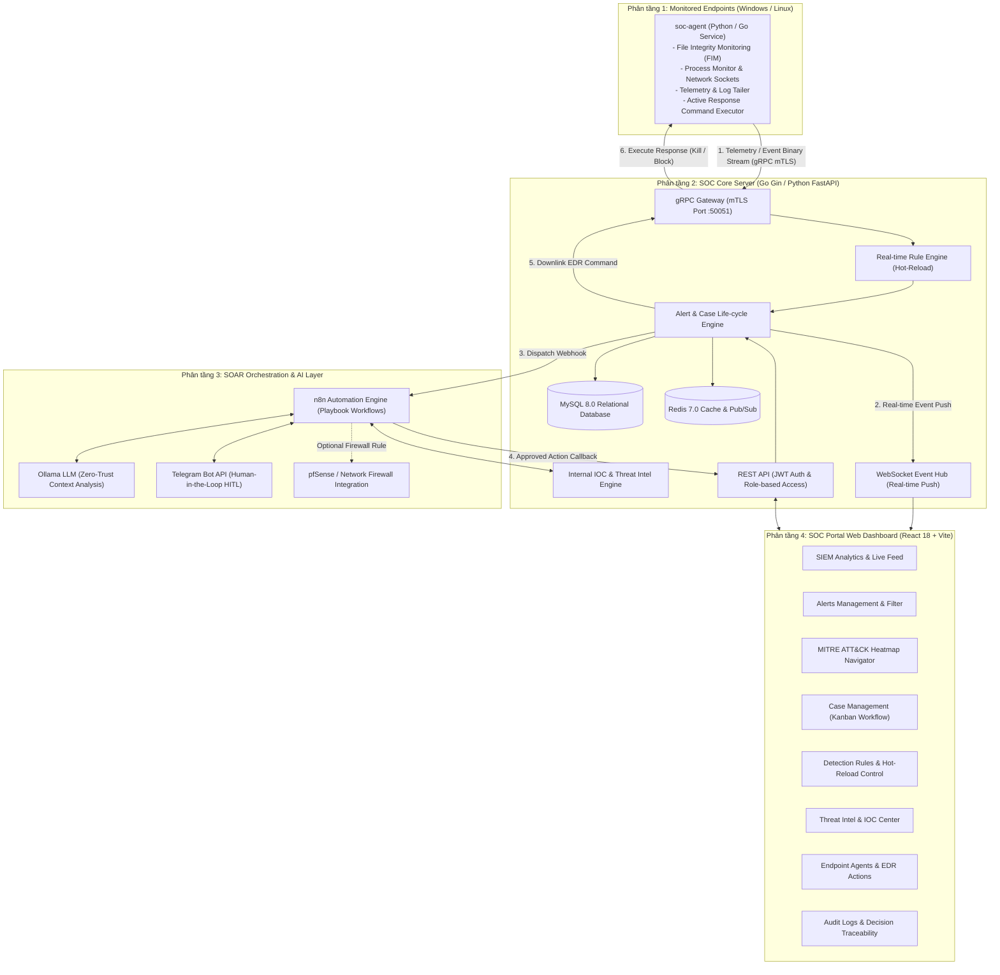

---

## Các tính năng nổi bật

- **Giao diện Web tập trung:** Xây dựng trên React 18, hỗ trợ đồng bộ hoàn toàn hai chế độ màu Dark Theme và Light Theme, tương thích phông chữ kỹ thuật chuẩn IBM Plex Sans và IBM Plex Mono.
- **Kênh giao tiếp gRPC mTLS:** Duy trì kết nối hai chiều liên tục, giảm thiểu độ trễ, loại bỏ thao tác hỏi vòng (polling) và xác thực chứng chỉ số giữa Server và Agent.
- **Quy trình Case Management chuẩn hóa:** Quản lý vòng đời sự cố theo mô hình Kanban (Mới, Đang xử lý, Đóng), bắt buộc phân công người phụ trách trước khi đóng vụ việc và tự động đồng bộ tiến trình xử lý.
- **Tích hợp mô hình phát hiện đa nguồn:** Kết hợp phát hiện theo luật (FIM, SSH, Web, Sysmon) với mô hình DDoS Machine Learning và mô hình Phishing AI.
- **Phân tích AI có kiểm soát:** LLM hoạt động với vai trò tham vấn Zero-Trust, sinh ra lý do phân tích (ai_reason) và điểm tin cậy (confidence), buộc phải qua bước xác nhận của chuyên viên khi vượt ngưỡng rủi ro.
- **Kiểm toán và hoàn tác an toàn:** Các hành động chặn IP đều có thời gian sống (TTL) giúp tự động gỡ chặn, tránh gây gián đoạn dịch vụ lâu dài; mọi bước xử lý đều được lưu vết vào nhật ký hệ thống.

---

## Giao diện người dùng và các phân hệ

### 1. Bảng điều khiển Tổng quan (Dashboard)

Cung cấp góc nhìn toàn cảnh về tình hình an ninh mạng trong toàn bộ hạ tầng. Hiển thị các thẻ chỉ số tổng hợp (cảnh báo mới, cảnh báo trong ngày, vụ việc đang mở, trạng thái kết nối Agent), biểu đồ diễn biến cảnh báo theo giờ và biểu đồ phân bố mức độ nghiêm trọng.


### 2. Giám sát và Quản lý Cảnh báo (Alerts)

Hàng đợi cảnh báo an ninh tập trung toàn bộ các sự kiện bất thường được Rule Engine phát hiện từ các Endpoint và cảm biến mạng. Chuyên viên có thể lọc theo mức độ nghiêm trọng, trạng thái xử lý, tìm kiếm theo ID/loại sự kiện hoặc mở chi tiết để chuyển đổi thành vụ việc điều tra.

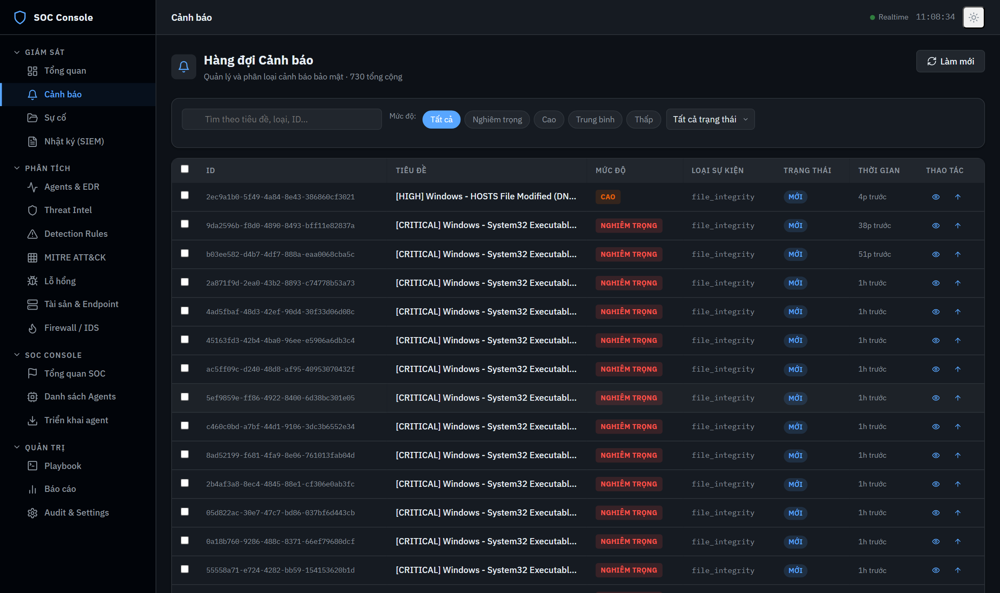

### 3. Ma trận Kỹ thuật Tấn công MITRE ATT&CK

Trực quan hóa độ phủ phát hiện của hệ thống theo 14 chiến thuật (Tactics) thuộc khung đánh giá MITRE ATT&CK Enterprise. Các kỹ thuật được kích hoạt nhiều lần (hits) được tô màu theo thang độ nhiệt giúp phân tích viên nhanh chóng xác định hướng tấn công chính.

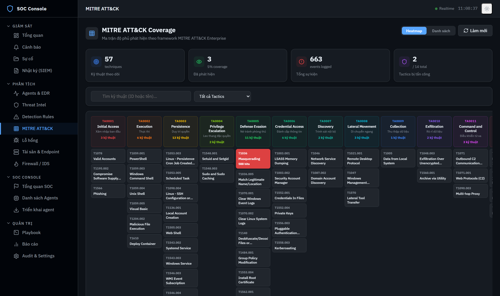

### 4. Quản lý Vụ việc An ninh (Case Management)

Quản lý danh sách vụ việc theo quy trình Kanban 3 cột: Mới tiếp nhận (New), Đang xử lý (In Progress) và Đã đóng (Closed). Hỗ trợ phân công người phụ trách (Assignee), áp dụng cơ chế chặn đóng vụ việc khi chưa phân công và tự động chuyển trạng thái sang Đang xử lý khi có người nhận nhiệm vụ.

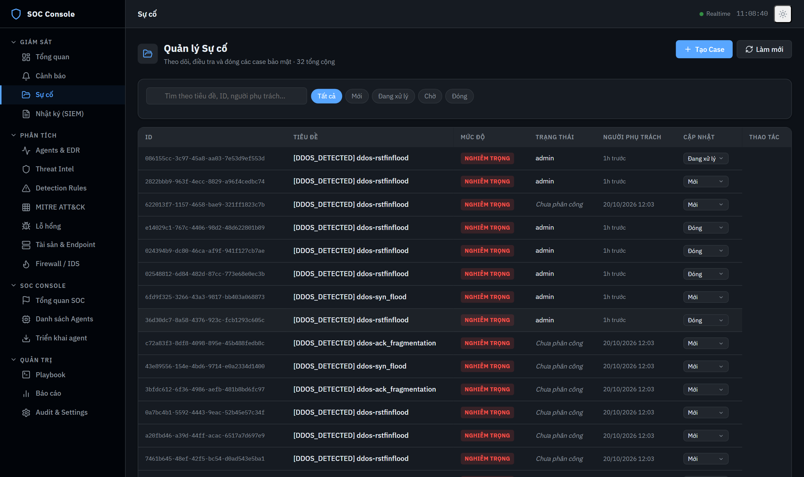

### 5. Chi tiết Vụ việc và Điều phối SOAR

Màn hình điều tra chuyên sâu theo bố cục 3 cột rõ ràng:
- **Cột trái:** Danh mục điều tra nhanh, ghi chú, thông tin SLA phản hồi và nguồn cảnh báo gốc.
- **Cột giữa:** Lý do phân tích của AI (AI Analysis Reason), độ tin cậy (Confidence), chi tiết thông số tấn công (IP nguồn, lưu lượng gói, agent liên quan) và payload dữ liệu thô dạng JSON.
- **Cột phải:** Người phụ trách (kèm nút Gán cho tôi), trạng thái vụ việc, nút Đóng case, thông tin liveness của Agent và các thẻ phân loại.

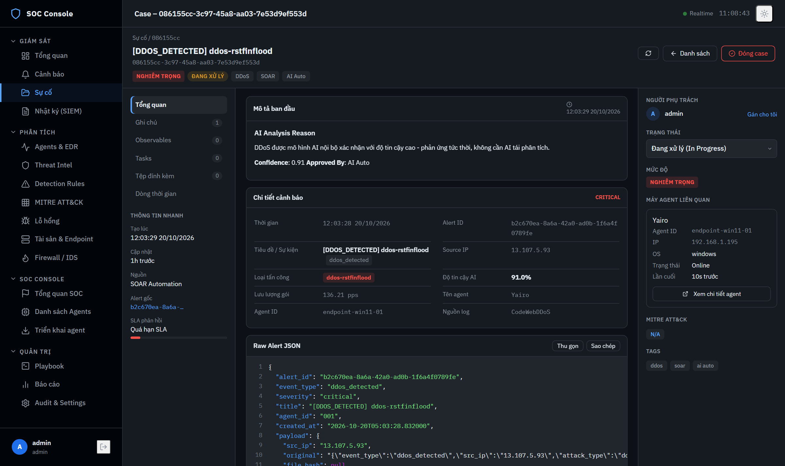

### 6. Quản lý Quy tắc Phát hiện (Detection Rules)

Cho phép quản trị viên theo dõi, thêm mới, chỉnh sửa, bật/tắt và xóa các luật phát hiện sự kiện an ninh. Hệ thống hỗ trợ cơ chế nạp lại luật tức thời (Hot-Reload) giúp cập nhật tập luật trực tiếp từ cơ sở dữ liệu vào bộ nhớ mà không cần khởi động lại server.

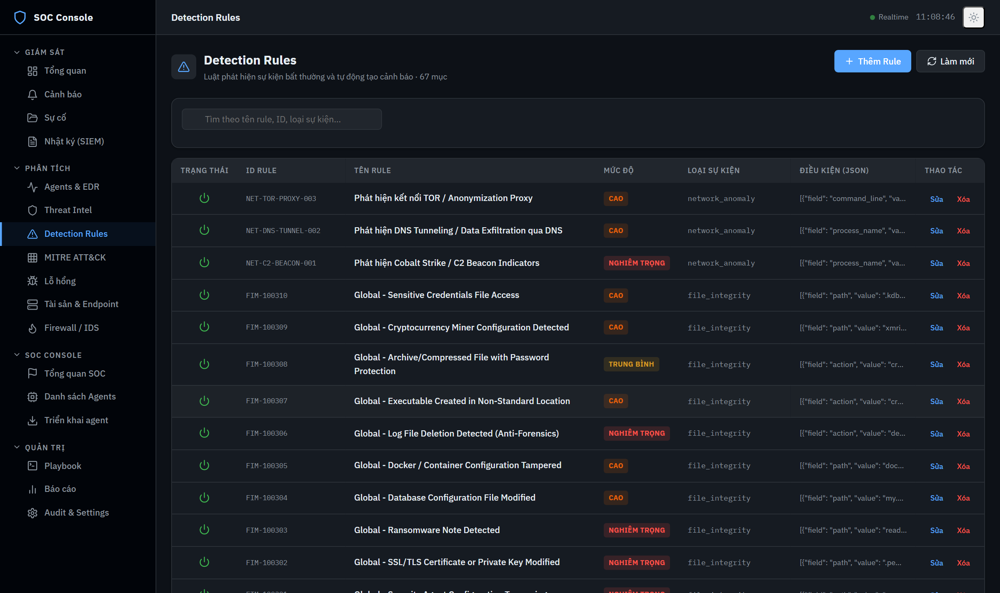

### 7. Trung tâm Tình báo Mối đe dọa (Threat Intel / IOC)

Quản lý tập trung danh mục các chỉ số xâm phạm an ninh mạng (IoC) bao gồm địa chỉ IP, tên miền (Domain), đường dẫn (URL) và mã băm tệp tin (File Hash). Tích hợp tính điểm tin cậy rủi ro (Abuse Score) và hỗ trợ tra cứu tự động trong quy trình SOAR.

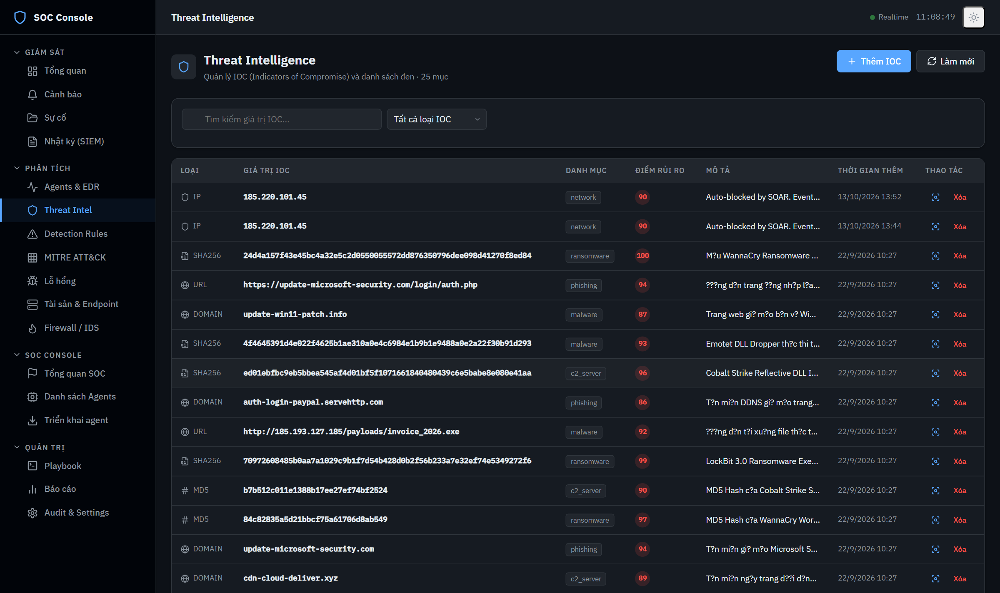

### 8. Giám sát Điểm cuối và EDR (Endpoint Agents)

Quản lý danh sách toàn bộ các soc-agent đang kết nối đến hệ thống. Theo dõi địa chỉ IP, hệ điều hành, mức tiêu thụ tài nguyên CPU/RAM, trạng thái kết nối gRPC stream và cung cấp menu kích hoạt các lệnh phản ứng EDR tức thời xuống máy đích.

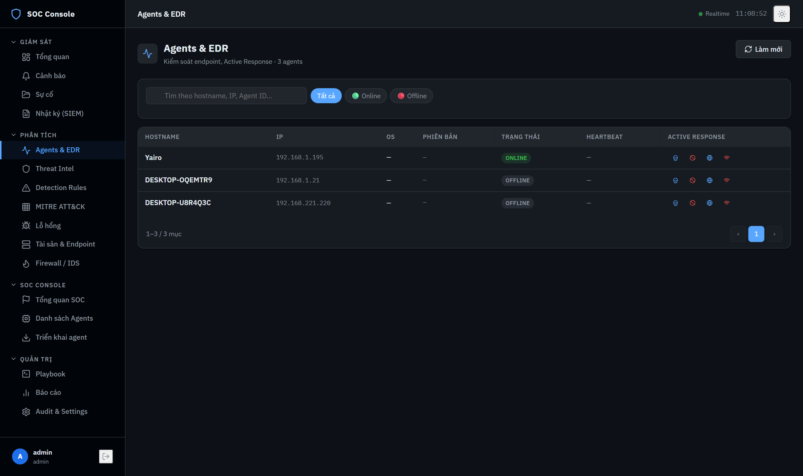

### 9. Nhật ký Sự kiện SIEM (Security Event Logs)

Kho lưu trữ và truy vấn nhật ký sự kiện tập trung. Hỗ trợ phân tích viên tra cứu toàn bộ dữ liệu telemetry thu thập từ các máy trạm theo thời gian thực, phục vụ công tác điều tra và xác minh dấu vết xâm nhập.

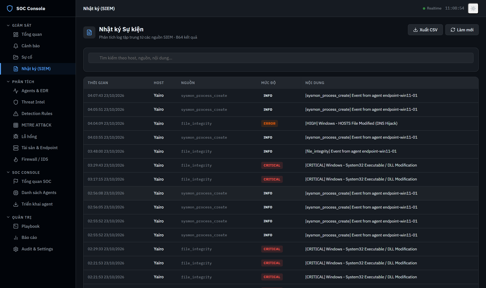

### 10. Danh mục Kịch bản Ứng phó Tự động (Playbooks)

Tổng hợp các kịch bản xử lý sự cố tự động hóa (SOAR Playbooks) đã được thiết lập trên hệ thống như: phòng chống dò mật khẩu SSH (SSH Brute Force), cách ly tệp tin mã độc (FIM), ngăn chặn tấn công từ chối dịch vụ (DDoS) và chặn kết nối đến máy chủ điều khiển độc hại.

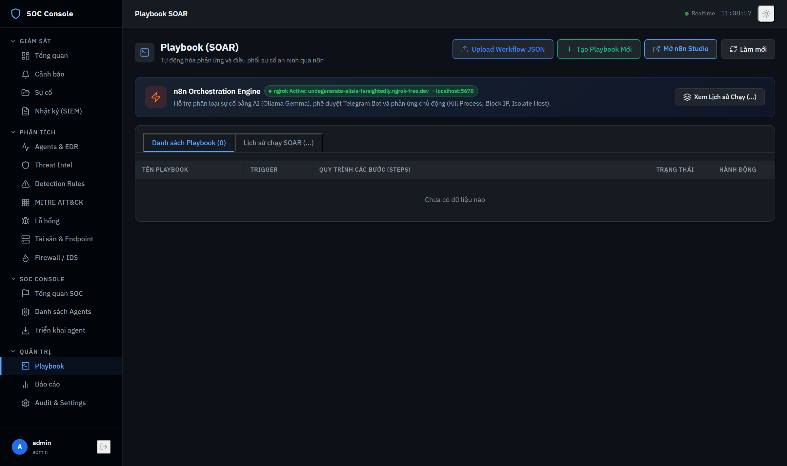

### 11. Nhật ký Kiểm toán Hệ thống (Audit Logs)

Lưu trữ toàn bộ nhật ký thao tác người dùng, các quyết định phê duyệt qua Telegram, các lệnh phản ứng EDR được truyền xuống Endpoint và kết quả phản hồi. Nhật ký tuân thủ tính bất biến và phục vụ công tác kiểm tra an ninh hệ thống.

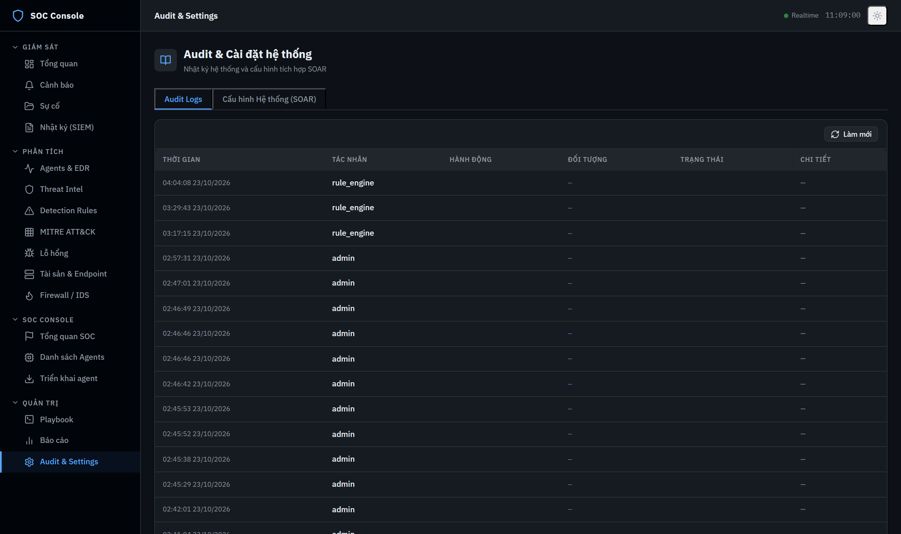

### 12. Quản lý Tường lửa và Chặn IP (Firewall & IDS)

Hiển thị danh sách các địa chỉ IP đang bị khóa bởi hệ thống tường lửa (trên Endpoint hoặc tại pfSense). Cung cấp thông tin thời gian hết hạn chặn (TTL) và lý do chặn, hỗ trợ gỡ chặn chủ động hoặc tự động hoàn tác khi hết thời hạn an toàn.

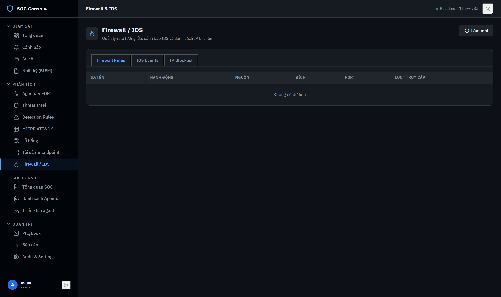

---

## Công nghệ sử dụng

| Phân hệ | Công nghệ / Thư viện sử dụng |
|---|---|
| **Core Server** | Go (Golang 1.22+), Gin Web Framework, gRPC Gateway, Protocol Buffers, GORM, Python FastAPI |
| **Endpoint Agent** | Python 3.11 / Go, gRPC Client, psutil, watchdog, Windows Service API, iptables / netsh |
| **Cơ sở dữ liệu & Cache** | MySQL 8.0 (lưu trữ quan hệ), Redis 7.0 (cache liveness, queue, pub/sub) |
| **Giao diện Web (Frontend)** | React 18, Vite, Vanilla CSS Design System, Recharts, Lucide React, Axios, WebSocket |
| **SOAR & AI Layer** | n8n Automation Engine, Ollama (Gemma / Llama LLM), Telegram Bot API, pfSense API |
| **Bảo mật & Xác thực** | Mutual TLS (mTLS), JWT Authentication, Role-based Access Control (RBAC), Token Header |

---

## Cấu trúc thư mục dự án

```
DO AN TOT NGHIEP/
├── soc-server/                     # Core Backend Service bằng Golang
│   ├── cmd/server/main.go          # Điểm khởi chạy Server
│   ├── configs/config.yaml         # Cấu hình Database, Redis, gRPC, Port
│   ├── internal/agent_grpc/        # Quản lý kết nối gRPC stream mTLS
│   ├── internal/rules/             # Rule Engine in-memory và loader YAML
│   ├── internal/services/          # Nghiệp vụ: Alert, Case, Audit, SOAR
│   └── internal/api/               # REST API Router, WebSocket Hub
│
├── soc-server-python/              # Backend Service bổ sung bằng Python
│   ├── app/main.py                 # Điểm khởi chạy FastAPI server
│   ├── app/routers/                # Router Alert, Case, Rules, ThreatIntel
│   └── app/services/               # Xử lý nghiệp vụ và tích hợp AI
│
├── soc-agent/                      # Agent thu thập bằng Golang
│   ├── main.go                     # Điểm khởi chạy agent
│   ├── collector/                  # Thu thập FIM, Tiến trình, Mạng, Logs
│   └── responder/                  # Thực thi phản ứng: Kill Process, Block IP
│
├── soc-agent-python/               # Agent thu thập bằng Python
│   ├── main.py                     # Điểm chạy tiến trình agent
│   ├── process_monitor.py          # Giám sát tiến trình hệ thống
│   └── install-agent.ps1           # Script cài đặt tự động trên Windows
│
├── soc-frontend/                   # Giao diện Web Dashboard
│   ├── src/components/             # Components giao diện (Layout, CaseAlertDetails)
│   ├── src/pages/                  # Dashboard, Cases, CaseDetail, MITRE, Rules...
│   ├── src/styles/                 # File định nghĩa CSS cho các phân hệ
│   └── src/contexts/               # Quản lý Auth, Theme (Dark/Light), WebSocket
│
├── docs/screenshots/               # Hình ảnh chụp giao diện phục vụ README
├── CodeWebDDoS/                    # Module kiểm thử và sinh lưu lượng DDoS
└── test_ddos_pipeline_e2e.py       # Script kiểm thử khép kín luồng DDoS SOAR
```

---

## Hướng dẫn cài đặt và vận hành

### Yêu cầu môi trường

- Hệ điều hành: Windows 10/11 hoặc Linux (Ubuntu 20.04 LTS trở lên)
- Python: >= 3.10
- Go (Golang): >= 1.22
- Node.js: >= 20.x và npm
- MySQL: >= 8.0 (Database: `soc_db`, User: `root`, Port: 3306)
- Redis: >= 6.0 (Port: 6379)
- Docker & Docker Compose (tùy chọn cho n8n và Ollama)

---

### Bước 1: Khởi động cơ sở dữ liệu và Redis

Khởi động MySQL 8.0 và Redis 7.0 trên máy chủ hoặc sử dụng Docker:

```powershell
docker compose up -d mysql redis
```

Kiểm tra kết nối đến cơ sở dữ liệu `soc_db` trên cổng 3306 và Redis trên cổng 6379.

---

### Bước 2: Khởi chạy Backend Server

Mở Terminal tại thư mục `soc-server-python`:

```powershell
cd "soc-server-python"
python -m venv venv
.\venv\Scripts\activate
pip install -r requirements.txt
python main.py
```

Server sẽ tự động khởi tạo database, tạo tài khoản quản trị mặc định, nạp các luật phát hiện và lắng nghe tại:
- REST API: `http://localhost:8080`
- gRPC Server: `localhost:50051`

---

### Bước 3: Khởi chạy Frontend Dashboard

Mở Terminal mới tại thư mục `soc-frontend`:

```powershell
cd "soc-frontend"
npm install
npm run dev
```

Truy cập hệ thống qua trình duyệt: **`http://localhost:5173`**
- Tài khoản mặc định: `admin`
- Mật khẩu: `admin123`

---

### Bước 4: Triển khai soc-agent trên Endpoint

Mở Terminal trên máy trạm điểm cuối cần giám sát:

```powershell
cd "soc-agent-python"
pip install -r requirements.txt
python main.py
```

Agent sẽ kết nối đến Server qua kênh gRPC, bắt đầu thu thập metrics, tiến trình, toàn vẹn tệp tin và lắng nghe lệnh phản ứng.

---

### Bước 5: Thiết lập Workflow n8n SOAR

1. Truy cập giao diện quản trị n8n tại `http://localhost:5678`.
2. Chọn **Import from File** và nạp file workflow `SOC SOAR - SOC Server Tot nghiep_Gioi.json`.
3. Điền mã Token Bot Telegram và Chat ID của quản trị viên vào node Telegram.
4. Kích hoạt (Activate) workflow để sẵn sàng tiếp nhận Webhook từ Core Server.

---

## Kịch bản kiểm thử thực tế

### Kịch bản 1: Phát hiện và phản ứng thay đổi tệp tin (FIM)

1. Tạo hoặc sửa đổi tệp tin bất thường trong thư mục giám sát trên máy Endpoint:
   ```powershell
   New-Item -ItemType Directory "C:\Users\Public\SOC-Test" -Force
   Set-Content "C:\Users\Public\SOC-Test\malware_payload.exe" "suspicious binary content"
   ```
2. Ngay lập tức, FIM module trên agent phát hiện sự kiện, tính toán mã băm SHA-256 và gửi qua gRPC stream.
3. Rule Engine trên server phát hiện sự kiện khớp với luật `FIM-100307`, tạo cảnh báo mức độ Critical và bắn qua WebSocket lên Dashboard thời gian thực.

### Kịch bản 2: Điều phối SOAR và Phê duyệt chặn qua Telegram (HITL)

1. Cảnh báo được hệ thống bắn sang n8n qua Webhook.
2. n8n truyền ngữ cảnh sang Ollama LLM để đánh giá mức độ rủi ro và sinh lý do phân tích.
3. Bot Telegram gửi thông báo đến chuyên viên trực kèm 2 lựa chọn: `[Phê duyệt Chặn]` và `[Bỏ qua]`.
4. Chuyên viên ấn Phê duyệt, n8n gọi REST callback về Server.
5. Server đẩy lệnh `BLOCK_IP` qua gRPC stream xuống Agent để chặn IP nguồn bằng firewall với thời gian TTL 60 phút.

### Kịch bản 3: Kiểm thử khép kín luồng DDoS (End-to-End Test)

Chạy script kiểm thử tự động để giả lập toàn bộ vòng đời từ phát hiện DDoS đến tạo case và phân công:

```powershell
python test_ddos_pipeline_e2e.py
```

Kết quả sẽ tạo ra case thực tế `[DDOS_DETECTED]` trên hệ thống, tự động gán cho analyst và hiển thị đầy đủ trên màn hình Kanban và Chi tiết Case.

---

## Tác giả và Đồ án

- **Đề tài:** Nghiên cứu, thiết kế và xây dựng Nền tảng Giám sát An ninh mạng (SOC), Điều phối và Phản ứng Sự cố Tự động (SOAR / EDR) hợp nhất ứng dụng gRPC, Trí tuệ Nhân tạo (AI) và Nền tảng Tự động hóa n8n.
- **Học viện:** Học viện Công nghệ Bưu chính Viễn thông - Cơ sở TP. Hồ Chí Minh
- **Khoa:** Công nghệ Thông tin 2 - Chuyên ngành An toàn Thông tin
- **Giảng viên hướng dẫn:** TS. Huỳnh Trọng Thưa
- **Sinh viên thực hiện:**
  - Nguyễn Đình Quốc Trí - MSSV: N22DCAT059 - Lớp: D22CQAT01-N
  - Hồ Lê Giỏi - MSSV: N22DCAT019 - Lớp: D22CQAT01-N
- **Mã nguồn dự án:** [tringuyenbmt123/do-an-tot-nghiep](https://github.com/tringuyenbmt123/do-an-tot-nghiep)